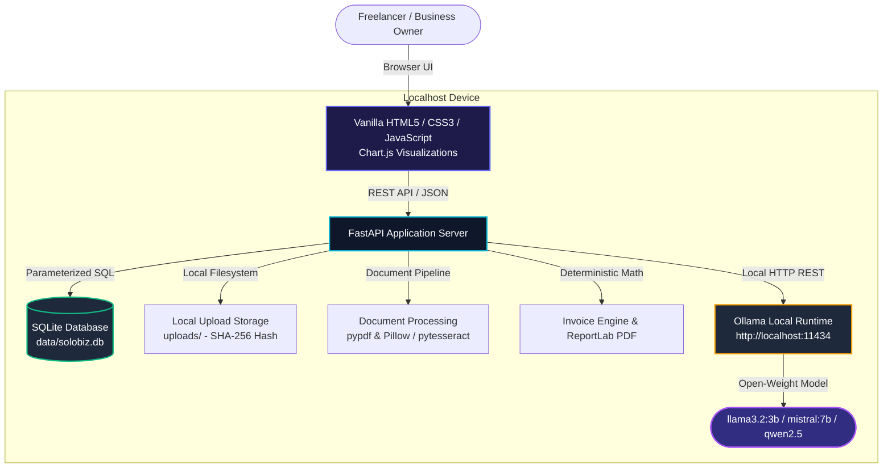

# SoloBiz AI — A Local-First AI Business Assistant

[](LICENSE)
[](https://www.python.org/)
[](https://fastapi.tiangolo.com/)
[](https://ollama.com/)
[](https://hacktoberfest.com/)
[](https://solobiz-ai.loca.lt)
[](https://render.com/deploy?repo=https://github.com/GenX0Gravity/SoloBiz-AI)

> **Live Interactive Demo:** [https://solobiz-ai.loca.lt](https://solobiz-ai.loca.lt) *(Tunnel Password / IP: `152.58.182.93`)*  
> **1-Click Render Deploy:** [Deploy to Render Blueprint](https://render.com/deploy?repo=https://github.com/GenX0Gravity/SoloBiz-AI)

**SoloBiz AI** is a privacy-first, on-device business intelligence and invoicing assistant designed for freelancers, solopreneurs, and small business owners. It provides automated invoice scanning, expense analytics, professional PDF invoice generation, and financial reasoning without ever sending sensitive financial documents or client data to external cloud AI APIs.

---

## Architecture Overview



---

## Why Open-Weight AI & Local-First?

| Dimension | Hosted Cloud APIs (OpenAI, Claude) | SoloBiz AI (Local-First Open Weights) |
| :--- | :--- | :--- |
| **Data Privacy** | Sensitive invoices, bank numbers, & client contracts leave your device and are processed on remote servers. | **100% On-Device:** Financial records never leave `localhost`. Zero cloud telemetry. |
| **Operating Cost** | Recurring token billing, subscription tiers, and API costs per document. | **Zero Recurring Cost:** Runs entirely on your existing hardware using open-weight models. |
| **Offline Resilience** | Broken workflows when offline or when external cloud services experience outages. | **Fully Functional Offline:** Expenses CRUD, invoice math, and PDF generation work with zero internet. |
| **Customizability** | Locked into vendor prompts and API deprecation cycles. | **Swappable Models:** Switch from `llama3.2:3b` to `qwen2.5` or `mistral:7b` via one environment variable. |
| **Hallucination Safeguard**| LLMs often invent math when summarizing totals. | **Deterministic Calculations:** All taxes, discounts, and totals are computed using Python `Decimal` logic. |

---

## Core Features

### 1. AI Invoice & Receipt Scanner
- **Multi-Format Ingestion:** Upload PDF invoices, PNG receipts, and JPEG receipts with drag-and-drop.
- **Two-Tier Extraction:**
  1. *Local AI Extraction:* Sandboxed prompt extraction via Ollama returning structured JSON.
  2. *Deterministic Rule Engine:* Regex-based parsing for amounts, dates, invoice numbers, and categories when Ollama is offline.
- **Prompt Injection Defense:** Untrusted document text is quarantined inside strict `<UNTRUSTED_DOCUMENT_TEXT>` delimiters with system prompts instructing the model to treat content purely as inert data.
- **Human Verification Drawer:** Extracted fields must be confirmed by the user before committing to the database. No hallucinated amounts are ever saved silently.
- **Deduplication:** SHA-256 content hashing detects duplicate document uploads.

### 2. Expense Manager
- **SQLite Storage:** Secure, indexed local database (`solobiz.db`) with parameterized queries.
- **Categorization:** Classifies expenses into `Software`, `Travel`, `Equipment`, `Marketing`, `Office Supplies`, `Legal & Professional`, `Utilities`, and `Other`.
- **Search & Filters:** Real-time filtering by category, merchant name, and date ranges.
- **Full CRUD:** Create manual entries, update records, or delete expenses with instant UI feedback.
- **CSV Export:** Download complete filtered expense records for tax accountants and spreadsheet analysis.

### 3. AI Business Assistant
- **Database-Grounded Insights:** Before answering user queries, the backend extracts actual database facts (burn rates, monthly spending, category totals, pending invoices) and provides them as immutable ground truth.
- **Fact vs. Suggestion Separation:** Responses clearly distinguish verified mathematical records (`[Verified Record]`) from business suggestions (`[Suggestion]`).
- **Graceful Offline Mode:** If Ollama is offline, the assistant transparently displays an offline advisory banner with one-click setup commands, while answering questions using direct SQLite database records.

### 4. Professional Invoice & PDF Generator
- **Deterministic Math:** Subtotals, percentage discounts, and tax rates are computed using Python `Decimal` arithmetic (`ROUND_HALF_UP`), eliminating floating-point rounding errors.
- **Live Interactive Preview:** Side-by-side editing where line items, rates, and client details update the invoice paper layout in real-time.
- **Downloadable PDF Export:** Generates high-resolution, vector-quality PDF invoices using ReportLab with clean typography, status pills, and company headers.
- **Invoice Status Tracking:** Track invoices across `Draft`, `Sent`, `Paid`, and `Overdue`.

---

## Supported Open-Weight Models

SoloBiz AI connects to Ollama on `http://localhost:11434`. You can configure your model using `OLLAMA_MODEL` in `.env`:

| Model | Size | Min RAM | License | Best Suited For | Ollama Command |
| :--- | :--- | :--- | :--- | :--- | :--- |
| **Llama 3.2** *(Recommended)* | 3B | 8 GB | Llama 3.2 Community | Fast JSON extraction, low latency | `ollama run llama3.2` |
| **Qwen 2.5** | 3B | 8 GB | Apache 2.0 | High precision structured document parsing | `ollama run qwen2.5:3b` |
| **Mistral** | 7B | 16 GB | Apache 2.0 | Complex financial reasoning & tax deduction tips | `ollama run mistral` |
| **Phi-3 Mini** | 3.8B | 8 GB | MIT | Ultra-efficient execution on lightweight laptops | `ollama run phi3:mini` |

*Note: The application remains 100% usable for manual expense entry and invoice generation even if you choose not to run Ollama.*

---

## Quickstart Guide

### Prerequisites
- Python 3.10, 3.11, 3.12, 3.13, or 3.14
- *(Optional for AI)* [Ollama](https://ollama.com/) installed on your machine
- *(Optional for Image OCR)* [Tesseract OCR](https://github.com/tesseract-ocr/tesseract) (PDF text extraction works out-of-the-box via `pypdf`)

### 1. Clone & Set Up Virtual Environment

```bash
# Clone the repository
git clone https://github.com/GenX0Gravity/SoloBiz-AI.git
cd SoloBiz-AI

# Create virtual environment
python -m venv venv

# Activate virtual environment
# On Windows (PowerShell):
.\venv\Scripts\Activate.ps1
# On macOS / Linux:
source venv/bin/activate
```

### 2. Install Dependencies

```bash
pip install -r requirements.txt
```

### 3. Configure Environment

```bash
cp .env.example .env
```

### 4. Run the Application Locally

```bash
python run.py
```

The launcher will initialize the database, seed realistic demo records, and open the server:
- **Web Dashboard:** `http://127.0.0.1:8000`
- **Interactive API Docs (Swagger):** `http://127.0.0.1:8000/docs`
- **Health Check Endpoint:** `http://127.0.0.1:8000/health`

---

## Production Deployment Guide

SoloBiz AI is container-ready and supports both local containerization and cloud PaaS deployments.

### Option A: Docker & Docker Compose (Recommended for Self-Hosting)

The repository includes a production `Dockerfile` with Tesseract OCR pre-installed and a `docker-compose.yml` with persistent storage volume mounts.

```bash
# 1. Build and start the container in detached mode
docker compose up --build -d

# 2. View logs
docker compose logs -f solobiz-ai

# 3. Check health status
curl http://localhost:8000/health
```

#### Connecting Docker to Host Ollama
The `docker-compose.yml` includes `extra_hosts: ["host.docker.internal:host-gateway"]` and sets `OLLAMA_HOST=http://host.docker.internal:11434`. This enables the Dockerized SoloBiz AI backend to communicate with an Ollama runtime running natively on your host machine without needing to expose Ollama to the public internet!

### Option B: Cloud Deployment on Render (with Persistent Disk)

SoloBiz AI includes a blueprint specification in `render.yaml`.

1. Fork or push this repository to GitHub.
2. Sign in to [Render](https://render.com/) and navigate to **Blueprints**.
3. Connect your repository (`SoloBiz-AI`). Render will automatically read `render.yaml`.
4. **Important for SQLite Persistence:**
   - Render automatically provisions a 1 GB persistent disk mounted at `/var/data`.
   - `DATA_DIR` is set to `/var/data/data` and `UPLOAD_DIR` to `/var/data/uploads`.
   - Your expenses database and uploaded receipts will persist across restarts and redeployments.
5. Click **Apply** to deploy.

### Cloud vs. Local AI Architecture Notes

- **Zero Cloud Crash Guarantee:** When deploying to standard cloud environments where a local GPU or Ollama runtime is not present, SoloBiz AI **does not fail or crash**. The application automatically detects that Ollama is unreachable and switches to its high-precision **Deterministic Rule Engine** and direct **SQLite Grounding Engine**.
- **Remote Ollama Host:** If you operate an Ollama instance on a dedicated private server or secure VPN, set `OLLAMA_HOST=https://your-private-ollama-host.internal` in your cloud environment variables.
- **Security Notice:** Never expose an unauthenticated Ollama port (`11434`) directly to the public internet. Always place remote inference behind a reverse proxy (e.g. Caddy/Nginx) with HTTP Basic Auth, WireGuard VPN, or Cloudflare Access tunnels.

---

## Running the Test Suite

SoloBiz AI includes unit and integration tests covering Decimal calculations, filename sanitization, PDF text extraction, duplicate detection, and FastAPI endpoints:

```bash
pytest -v
```

Expected result:
```text
tests/test_api.py::test_health_endpoint PASSED
tests/test_api.py::test_ai_status_endpoint PASSED
tests/test_api.py::test_create_and_get_expense PASSED
tests/test_api.py::test_create_and_pdf_invoice PASSED
tests/test_api.py::test_export_csv PASSED
tests/test_api.py::test_upload_pdf_receipt PASSED
tests/test_calculations.py::test_basic_invoice_calculation PASSED
tests/test_calculations.py::test_zero_tax_and_zero_discount PASSED
tests/test_calculations.py::test_decimal_rounding_precision PASSED
tests/test_document_service.py::test_sanitize_filename PASSED
tests/test_document_service.py::test_validate_file_metadata PASSED
tests/test_document_service.py::test_pdf_extraction_and_rule_parser PASSED

======================= 12 passed in 5.88s =======================
```

---

## Project Structure

```text
SoloBiz AI/
├── backend/
│   ├── __init__.py
│   ├── config.py                 # Configuration and environment defaults
│   ├── database.py               # SQLite connection manager & schema migrations
│   ├── models.py                 # Pydantic schemas for validation & serialization
│   ├── main.py                   # FastAPI REST API routes and static mounting
│   ├── seed_data.py              # Realistic sample data for instant demo
│   ├── generate_samples.py       # Generates sample PDF & image receipts
│   └── services/
│       ├── __init__.py
│       ├── ai_service.py         # Ollama integration, grounding & rule-based parser
│       ├── document_service.py   # Safe file handling, PDF & OCR extraction
│       ├── invoice_service.py    # Decimal math & ReportLab PDF generator
│       └── analytics_service.py  # Trend metrics, category spend & CSV export
├── frontend/
│   ├── index.html                # Single-page SaaS dashboard
│   ├── css/
│   │   └── style.css             # Dark-mode design system with glassmorphism
│   └── js/
│       ├── api.js                # Frontend API client
│       ├── app.js                # App state, routing, modals, and event handlers
│       └── charts.js             # Chart.js visualization wrappers
├── tests/
│   ├── __init__.py
│   ├── test_calculations.py      # Precision & rounding test suite
│   ├── test_document_service.py  # File validation & extraction tests
│   └── test_api.py               # FastAPI integration test suite
├── sample_receipts/              # Generated test receipts for quick testing
├── data/                         # SQLite database storage (git-ignored)
├── uploads/                      # Local document storage (git-ignored)
├── requirements.txt              # Production Python dependencies
├── .env.example                  # Environment configuration template
├── run.py                        # Top-level runner script
└── README.md                     # Comprehensive documentation
```

---

## Security & Reliability Design

- **SQL Injection Prevention:** Every database query strictly uses parameterized placeholders (`?`).
- **Directory Traversal Protection:** Uploaded filenames are stripped of path tokens, null bytes, and non-printable characters via `sanitize_filename()`.
- **Upload Restrictions:** Enforces file size limits (15 MB default) and validates file extensions and MIME types.
- **Prompt Injection Defense:** User-uploaded document text is isolated within inert XML tags and sandboxed from execution.
- **Verification Guarantee:** Extracted amounts from OCR/LLM are never committed to expenses until the user verifies them in the UI.

---

## Contributing & Hacktoberfest

Contributions are warmly welcomed! Here are great areas to get involved:

- [ ] **Multi-Currency Support:** Support EUR, GBP, CAD, INR with dynamic currency symbols.
- [ ] **Tax Jurisdiction Presets:** Add pre-configured sales tax / VAT presets for US states, Canada GST/HST, and European VAT.
- [ ] **Invoice PDF Themes:** Add alternative ReportLab templates (Minimalist, Classic Serif, Modern Bold).
- [ ] **Direct Scanner Camera Input:** Add WebRTC mobile camera capture for taking photos of receipts directly in browser.

### Contribution Steps
1. Fork the repository.
2. Create a feature branch (`git checkout -b feature/amazing-feature`).
3. Commit your changes with clear messages (`git commit -m 'Add tax jurisdiction presets'`).
4. Run tests to ensure everything passes (`pytest -v`).
5. Open a Pull Request!

---

## License

This project is licensed under the [MIT License](LICENSE) — free for personal and commercial use.
